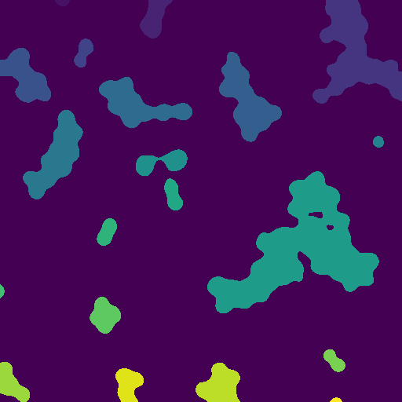

# AFMSlicer at the Command Line

Once you have [installed](../installation.md) AFMSlicer within a virtual environment you can start using the Command Line
Interface. The command is called `afmslicer` and it has a useful `--help` flag which lists the available options.

``` shell
afmslicer --help
usage: afmslicer [-h] [-v] [-c CONFIG_FILE] [-b BASE_DIR] [-o OUTPUT_DIR] [-l LOG_LEVEL] [-j CORES] [-f FILE_EXT] [--channel CHANNEL] {process,filter,slicer,create-config} ...

Run various processing steps for slicing AFM images of bacterial cell walls.

options:
  -h, --help            show this help message and exit
  -v, --version         Report the current version of AFMSlicer that is installed
  -c CONFIG_FILE, --config-file CONFIG_FILE
                        Path to a YAML configuration file.
  -b BASE_DIR, --base-dir BASE_DIR
                        Base directory to scan for images.
  -o OUTPUT_DIR, --output-dir OUTPUT_DIR
                        Output directory to write results to.
  -l LOG_LEVEL, --log-level LOG_LEVEL
                        Logging level to use, default is 'info' for verbose output use 'debug'.
  -j CORES, --cores CORES
                        Number of CPU cores to use when processing.
  -f FILE_EXT, --file-ext FILE_EXT
                        File extension to scan for.
  --channel CHANNEL     Channel to extract.

program:
  Available processing options are:

  {process,filter,slicer,create-config}
    process             Process all images, slicing and summarising statistics across slices and plotting results.
    filter              Load and filter images, saving as .afmslicer files for subsequent processing.
    slicer              Load and slice images, saving as '.topostats' files for subsequent processing.
    create-config       Create a configuration file using the defaults.
```

Command line options should be self-explanatory.

## Processing

The most common step is to batch process each image from end-to-end. This involves...

- identifying all files with the given extension (default is `.spm`).
- loading each file and extracting the `channel` (default is `height`).
- filtering the image which involves flattening and removing tilt and optionally removing scars.
- slicing the image.
- segmenting the image to identify cell structures.
- calculating statistics on each segment and generating images.
- aggregating statistics and writing output to disk.

AFMSlicer comes with a default configuration file that will be loaded, to use these defaults to process images in the
`data/` directory run

``` shell
afmslicer --base-dir data/ process
```

You should see output similar to the following.

``` shell
[Thu, 26 Mar 2026 11:14:21] [INFO    ] [topostats] The YAML configuration file is valid.
2026-03-26 11:14:21.463 | INFO     | afmslicer.run_modules:_log_setup:61 - Configuration file loaded from      : None
2026-03-26 11:14:21.463 | INFO     | afmslicer.run_modules:_log_setup:62 - Scanning for images in              : tests
2026-03-26 11:14:21.463 | INFO     | afmslicer.run_modules:_log_setup:63 - Output directory                    : output
2026-03-26 11:14:21.463 | INFO     | afmslicer.run_modules:_log_setup:64 - Looking for images with extension   : .spm
2026-03-26 11:14:21.463 | INFO     | afmslicer.run_modules:_log_setup:65 - Images with extension .spm in tests : 2
2026-03-26 11:14:21.463 | INFO     | afmslicer.run_modules:_log_setup:68 - Slices per image                    : 50
[Thu, 26 Mar 2026 11:14:21] [INFO    ] [topostats] Extracting image from tests/resources/spm/sample2.spm
2026-03-26 11:14:21.464 | INFO     | AFMReader.spm:load_spm:89 - Loading image from : tests/resources/spm/sample2.spm
2026-03-26 11:14:21.465 | INFO     | AFMReader.spm:load_spm:94 - [sample2] : Loaded image from : tests/resources/spm/sample2.spm
2026-03-26 11:14:21.499 | INFO     | AFMReader.spm:load_spm:96 - [sample2] : Extracted channel Height
2026-03-26 11:14:21.502 | INFO     | AFMReader.spm:spm_pixel_to_nm_scaling:53 - [sample2] : Pixel to nm scaling : 0.625
[Thu, 26 Mar 2026 11:14:21] [INFO    ] [topostats] Extracting image from tests/resources/spm/sample1.spm
2026-03-26 11:14:21.503 | INFO     | AFMReader.spm:load_spm:89 - Loading image from : tests/resources/spm/sample1.spm
2026-03-26 11:14:21.504 | INFO     | AFMReader.spm:load_spm:94 - [sample1] : Loaded image from : tests/resources/spm/sample1.spm
2026-03-26 11:14:21.527 | INFO     | AFMReader.spm:load_spm:96 - [sample1] : Extracted channel Height
2026-03-26 11:14:21.528 | INFO     | AFMReader.spm:spm_pixel_to_nm_scaling:53 - [sample1] : Pixel to nm scaling : 39.0625
Processing images from tests, results are under output:   0%|                      | 0/2 [00:00<?, ?i2026-03-26 11:14:21.994 | INFO     | afmslicer.processing:filter_scan:103 - [sample1] : Filtering complete 😻
2026-03-26 11:14:21.996 | INFO     | afmslicer.classes:__post_init__:158 - [sample1] : AFMSlicer object created. 🔪
2026-03-26 11:14:22.203 | INFO     | afmslicer.processing:filter_scan:103 - [sample2] : Filtering complete 😻
2026-03-26 11:14:22.204 | INFO     | afmslicer.classes:__post_init__:158 - [sample2] : AFMSlicer object created. 🔪
2026-03-26 11:14:23.182 | INFO     | afmslicer.plotting:plot_layer:74 - Image saved to : output/sample1_0.png
2026-03-26 11:14:23.219 | INFO     | afmslicer.plotting:plot_layer:74 - Image saved to : output/sample1_1.png
2026-03-26 11:14:23.256 | INFO     | afmslicer.plotting:plot_layer:74 - Image saved to : output/sample1_2.png
2026-03-26 11:14:23.293 | INFO     | afmslicer.plotting:plot_layer:74 - Image saved to : output/sample1_3.png
2026-03-26 11:14:23.330 | INFO     | afmslicer.plotting:plot_layer:74 - Image saved to : output/sample1_4.png
2026-03-26 11:14:23.375 | INFO     | afmslicer.plotting:plot_layer:74 - Image saved to : output/sample1_5.png
2026-03-26 11:14:23.412 | INFO     | afmslicer.plotting:plot_layer:74 - Image saved to : output/sample1_6.png
2026-03-26 11:14:23.449 | INFO     | afmslicer.plotting:plot_layer:74 - Image saved to : output/sample1_7.png
2026-03-26 11:14:23.492 | INFO     | afmslicer.plotting:plot_layer:74 - Image saved to : output/sample1_8.png
2026-03-26 11:14:23.534 | INFO     | afmslicer.plotting:plot_layer:74 - Image saved to : output/sample1_9.png
2026-03-26 11:14:23.577 | INFO     | afmslicer.plotting:plot_layer:74 - Image saved to : output/sample1_10.png
2026-03-26 11:14:23.616 | INFO     | afmslicer.plotting:plot_layer:74 - Image saved to : output/sample1_11.png
2026-03-26 11:14:23.654 | INFO     | afmslicer.plotting:plot_layer:74 - Image saved to : output/sample1_12.png
...
2026-03-26 11:14:26.256 | INFO     | afmslicer.plotting:plot_layer:74 - Image saved to : output/sample2_42.png
2026-03-26 11:14:26.370 | INFO     | afmslicer.plotting:plot_layer:74 - Image saved to : output/sample2_43.png
2026-03-26 11:14:26.414 | INFO     | afmslicer.plotting:plot_layer:74 - Image saved to : output/sample2_44.png
2026-03-26 11:14:26.464 | INFO     | afmslicer.plotting:plot_layer:74 - Image saved to : output/sample2_45.png
2026-03-26 11:14:26.513 | INFO     | afmslicer.plotting:plot_layer:74 - Image saved to : output/sample2_46.png
2026-03-26 11:14:26.562 | INFO     | afmslicer.plotting:plot_layer:74 - Image saved to : output/sample2_47.png
2026-03-26 11:14:26.603 | INFO     | afmslicer.plotting:plot_layer:74 - Image saved to : output/sample2_48.png
2026-03-26 11:14:26.646 | INFO     | afmslicer.plotting:plot_layer:74 - Image saved to : output/sample2_49.png
2026-03-26 11:14:27.100 | INFO     | afmslicer.plotting:generate_gif:278 - GIF saved to : output/sample2.gif
Processing images from tests, results are under output:  50%|███████████           | 1/2 [00:05<00:05,  5.59s2026-03-26 11:14:27.149 | INFO     | afmslicer.run_modules:process:189 - [sample1] Processing completed.
2026-03-26 11:14:27.167 | INFO     | afmslicer.plotting:plot_pores_by_layer:177 - Image saved to : output/sample2_pores_per_layer.png
2026-03-26 11:14:27.230 | INFO     | afmslicer.plotting:plot_pores_by_layer:177 - Image saved to : output/sample2_pores_per_layer_log.png
2026-03-26 11:14:27.300 | INFO     | afmslicer.plotting:plot_area_by_layer:240 - Image saved to : output/sample2_area_per_layer.png
2026-03-26 11:14:27.353 | INFO     | afmslicer.plotting:plot_area_by_layer:240 - Image saved to : output/sample2_area_per_layer_log.png
2026-03-26 11:14:27.357 | INFO     | afmslicer.processing:slicer_scan:156 - [sample2] Slicing complete 😻
Processing images from tests, results are under output: 100%|███████████████████████| 2/2 [00:07<00:00,  3.36s2026-03-26 11:14:28.947 | INFO     | afmslicer.run_modules:process:189 - [sample2] Processing completed.
Processing images from tests, results are under output: 100%|███████████████████████| 2/2 [00:07<00:00,  3.70s
2026-03-26 11:14:29.008 | INFO     | afmslicer.run_modules:completion_message:305 -

~~~~~~~~~~~~~~~~~~~~~~~~~~~~~~~~~~~~~~~~~~~~~~~~~~~~~~~~~~~~~~~~~~~~~~~~~~~~~~~~~~~~~~~~~~~~~~~~~~~~


   _____       _____    __    __    ______    __        __     _____     _____    __ __
  /\___/\    /\_____\  /_/\  /\_\  / ____/\  /\_\      /\_\   /\ __/\  /\_____\  /_/\__/\
 / / _ \ \  ( (  ___/  ) ) \/ ( (  ) ) __\/ ( ( (      \/_/   ) )__\/ ( (_____/  ) ) ) ) )
 \ \(_)/ /   \ \ \_   /_/ \  / \_\  \ \ \    \ \_\      /\_\ / / /     \ \__\   /_/ /_/_/
 / / _ \ \   / / /_\  \ \ \\// / /  _\ \ \   / / /__   / / / \ \ \_    / /__/_  \ \ \ \ \
( (_( )_) ) / /____/   )_) )( (_(  )____) ) ( (_____( ( (_(   ) )__/\ ( (_____\  )_) ) \ \
 \/_/ \_\/  \/_/       \_\/  \/_/  \____\/   \/_____/  \/_/   \/___\/  \/_____/  \_\/ \_\/


2026-03-26 11:14:29.008 | INFO     | afmslicer.run_modules:completion_message:309 -

~~~~~~~~~~~~~~~~~~~~~~~~~~~~~~~~~~~~~~~~~~~~~ COMPLETE ~~~~~~~~~~~~~~~~~~~~~~~~~~~~~~~~~~~~~~~~~~~~~

  AFMSlicer Version           : 0.1
  AFMSlicer Commit            : cd24434e2.d20251114
  Base Directory              : tests
  File Extension              : .spm
  Files Found                 : 2
  Successfully Processed^1    : 2 (100.0%)
  All statistics              : output/statistics.csv
  Configuration               : output/config.yaml

  Email                       : afmslicer@sheffield.ac.uk
  Documentation               : https://afm-spm.github.io/afmslicer/
  Source Code                 : https://github.com/AFM-SPM/AFMSlicer/
  Bug Reports/Feature Request : https://github.com/AFM-SPM/AFMSlicer/issues/new/choose
  Citation File Format        : https://github.com/AFM-SPM/AFMSlicer/blob/main/CITATION.cff

  ^1 Successful processing of an image is slicing an image, calculating and plotting
     statistics. If these have been disabled the percentage will be 0.

  If you encounter bugs/issues or have feature requests please report them at the above URL
  or email us.

  If you have found AFMSlicer useful please consider citing it. A Citation File Format is
  linked above and available from the Source Code page.
~~~~~~~~~~~~~~~~~~~~~~~~~~~~~~~~~~~~~~~~~~~~~~~~~~~~~~~~~~~~~~~~~~~~~~~~~~~~~~~~~~~~~~~~~~~~~~~~~~~~
```

## Output

Output is saved, by default to the `output/` directory. Within this directory there is a sub-directory for each image
file that has been processed which contains the output from processing that specific image.

For each image that has been processed you will find a `.png` image for each slice as well as a `.gif` for each
image. Results are saved to `.csv` files.

At the top level of the output directory (default `output/`) there are three `.csv` files that hold the aggregated
output across all processed images as well as a copy of the configuration and a log file.

```shell
(.venv) ❱ l output
drwxr-xr-x user1 user1  4.0 KB Thu Oct 22 14:08:18 2026  .
drwxr-xr-x user1 user1  4.0 KB Thu Oct 22 14:07:43 2026  ..
.rw-r--r-- user1 user1   64 KB Thu Oct 22 14:08:18 2026  2026-10-22-13-07-43.log
.rw-r--r-- user1 user1   11 KB Thu Oct 22 14:08:18 2026  all_color_count.csv
.rw-r--r-- user1 user1   22 KB Thu Oct 22 14:08:18 2026  all_hcfa.csv
.rw-r--r-- user1 user1  295 KB Thu Oct 22 14:08:18 2026  all_statistics.csv
.rw-r--r-- user1 user1 1022 B  Thu Oct 22 14:08:18 2026  config.yaml
drwxr-xr-x user1 user1   12 KB Thu Oct 22 14:08:06 2026  sample1
drwxr-xr-x user1 user1   12 KB Thu Oct 22 14:08:09 2026  sample2
```

| File                      | Description                                                                                    |
|---------------------------|------------------------------------------------------------------------------------------------|
| `all_hcfa.csv`            | HCFA statistics aggregated from all processed files.                                           |
| `all_statistics.csv`      | All statistics aggregated from all processed files.                                            |
| `all_colour_count.csv`    | Counts of objects classified by size into coloured groups aggregated across all process files. |
| `YYYY-MM-DD-hh-mm-ss.log` | Log-file from run.                                                                             |
| `config.yaml`             | Copy of configuration used for the run.                                                        |

### `all_statistics.csv`

This file has five columns

- `image` - the filename (minus extension) the row refers to.
- `layer` - the slice/layer the row refers to.
- `pore` - the numbered pore within the given layer.
- `area` - the area of the pore.
- `pore_color` - classification of the pore size.

``` shell
─────┬─────────────────────────────────────
     │ File: output/all_statistics.csv
─────┼─────────────────────────────────────
   1 │ image,layer,pore,area,pore_color
   2 │ sample1,0,0,399998474.12109375,blue
   3 │ sample1,1,0,396571350.09765625,blue
   4 │ sample1,2,0,390835571.2890625,blue
   5 │ sample1,3,0,349429321.2890625,blue
   6 │ sample1,3,1,17481994.62890625,blue
   7 │ sample1,3,2,576782.2265625,blue
   8 │ sample1,3,3,152587.890625,blue
   9 │ sample1,4,0,323004150.390625,blue
  10 │ sample1,4,1,16612243.65234375,blue
  11 | ...
```

### `all_color_count.csv`

This file has seven columns.

- `image` - the filename (minus extension) the row refers to.
- `layer` - the slice/layer the row refers to.
- `blue` - number of pores within sample/layer classified as `blue`.
- `green` - number of pores within sample/layer classified as `green`.
- `magenta` - number of pores within sample/layer classified as `magenta`.
- `yellow` - number of pores within sample/layer classified as `yellow`.
- `total` - number of pores within sample/layer.

``` shell
─────┬────────────────────────────────────────────
     │ File: output/color_count.csv
─────┼────────────────────────────────────────────
   1 │ image,layer,blue,green,magenta,yellow,total
   2 │ sample1,0,1,0,0,0,1
   3 │ sample1,1,1,0,0,0,1
   4 │ sample1,2,1,0,0,0,1
   5 │ sample1,3,4,0,0,0,4
   6 │ sample1,4,7,0,0,0,7
   7 │ sample1,5,6,0,0,0,6
   8 │ sample1,6,12,0,0,0,12
   9 │ sample1,7,23,0,0,0,23
  10 │ sample1,8,27,0,0,0,27
  11 │ ...
```

### `all_hcfa.csv`

This file has five columns.

- `layer` - the slice/layer the row refers to.
- `fraction` - the fraction of area covered by objects, the default is `0.5` and typically never needs changing,
  although it is possible if desirable.
- `area` - the area covered by the objects in this layer.
- `cumulative_fraction` - the cumulative fraction of the area covered, for those near the top and bottom slices this
  will be close to `0.0` or `1.0` but for the middle slices that are of interest this will be closed to `fraction`
  (i.e. `~0.5`).
- `image` - the filename (minus extension) the row refers to.

```shell
─────┬──────────────────────────────────────────────
     │ File: all_hcfa.csv
─────┼──────────────────────────────────────────────
   1 │ layer,fraction,area,cumulative_fraction,image
   2 │ 0,0.5,399998474.12109375,1.0,sample1
   3 │ 1,0.5,399374389.6484375,1.0,sample1
   4 │ 2,0.5,398596191.40625,1.0,sample1
   5 │ 3,0.5,397831726.07421875,1.0,sample1
   6 │ 4,0.5,397215270.99609375,1.0,sample1
   7 │ 5,0.5,396640014.6484375,1.0,sample1
   8 │ 6,0.5,395877075.1953125,1.0,sample1
   9 │ 7,0.5,394754028.3203125,1.0,sample1
```

### Individual Images

For each AFM scan that has been processed there is a directory within the specified output directory (default `output/`)
with the name of the scan file (minus the file extension). There are two `.csv` files, a `.gif` and many `.png` files.

```shell
(.venv) ❱ l output/sample1
drwxr-xr-x user1 user1  12 KB Thu Oct 22 14:08:06 2026  .
drwxr-xr-x user1 user1 4.0 KB Thu Oct 22 14:08:18 2026  ..
.rw-r--r-- user1 user1 292 KB Thu Oct 22 14:08:06 2026  cumulative_area.csv
.rw-r--r-- user1 user1  10 KB Thu Oct 22 14:08:06 2026  hcfa.csv
.rw-r--r-- user1 user1 904 KB Thu Oct 22 14:08:06 2026  sample1.gif
.rw-r--r-- user1 user1 2.3 KB Thu Oct 22 14:07:49 2026  sample1_0.png
.rw-r--r-- user1 user1 2.4 KB Thu Oct 22 14:07:49 2026  sample1_1.png
.rw-r--r-- user1 user1 3.0 KB Thu Oct 22 14:07:50 2026  sample1_10.png
...
.rw-r--r-- user1 user1 7.6 KB Thu Oct 22 14:07:55 2026  sample1_99.png
.rw-r--r-- user1 user1  35 KB Thu Oct 22 14:08:06 2026  sample1_area_per_layer.png
.rw-r--r-- user1 user1  27 KB Thu Oct 22 14:08:06 2026  sample1_area_per_layer_log.png
.rw-r--r-- user1 user1  34 KB Thu Oct 22 14:08:06 2026  sample1_pores_per_layer.png
```

| File                             | Description                                                                                              |
|----------------------------------|----------------------------------------------------------------------------------------------------------|
| `cumulative_area.csv`            | The cumulative area of each layer, used to produce `hcfa.csv`.                                           |
| `hcfa.csv`                       | Half Cumulative Fraction Area for each layer.                                                            |
| `<image>.gif`                    | A `.gif` animation of areas by slice in sequential order.                                                |
| `<image>_#.png`                  | A plot of a single layer `#`, there is one plot for the number of slices requested in the configuration. |
| `<image>_area_per_layer_log.png` | A graph of the layer v's the logarithm of the area of pores within it.                                   |
| `<image>_area_per_layer.png`     | A graph of the layer v's the area of pores within it.                                                    |
| `<image>_area_per_layer.png`     | A graph of the layer v's the number of pores within it.                                                  |

#### Plots

An example of an individual plot is shown below. Each independent pore/object is labelled in a unique colour with the
background areas as dark blue.




For each input file a number of summary plots are also generated  in the output directory. These show the number of
pores per layer with a Gaussian distribution overlaid and the full-width half max range marked on the graph. This
determines the range of layers for which the area per layer and the log-area per layer are then plotted.

**TODO** - Add in plots from a good run
