# Napari

[Napari][napari] is an extensible framework for viewing, processing and manipulating images and we have developed a
plugin to use AFMslicer in Napari, [napari-afmslicer][napari_afmslicer].

## Installation

If you have followed the [installation](../installation.md) instructions to install [napari-afmslicer][napari_afmslicer]
from PyPI or from a clone repository you will, obviously, already have [napari-afmslicer][napari_afmslicer] and its
dependencies installed.

However, it is possible that you may have followed the [Napari installation guide][napari_install] which installs Napari
_without_ any plugins. Because the `napari-afmslicer` has been released to PyPI it is also available in the [Napari
Hub][napari_hub] which means you can then install `napari-afmslicer` from within Napari via the _Plugins >
Install/Uninstall Plugins_ menu item. Search for `afmslicer`

### Dependencies

`napari-afmslicer` includes a small selection of plugins as dependencies and these are pulled in automatically when you
install `napari-afmslicer`.

- [napari-afmreader][napari_afmreader] - used to load a range of Atomic Force Microscopy images.
- [napari-crop][napari_crop] - used for cropping images (typically prior to filtering and slicing).
- [napari-skimage][napari_skimage] - Napari interface to [Scikit Image][skimage] functions.
- [napari-topostats][napari_topostats] - required as some of the functionality is reused.

The `napari-crop` and `napari-skimage` plugins in particular may be of use to further pre-process images prior to
slicing but they are _not_
developed or maintained by the developers of `napari-afmslicer`. If you encounter problems with either of these plugins
please contact the developers of those packages.

## Usage

<!-- markdownlint-disable MD046 -->
!!! Info

    In the following the term "widget" refers to a panel for processing an image with various settings. These typically
    include a menu at the top for selecting which image to apply the processing to. Most of the options have tool-tips
    which when you move the mouse over will appear and describe information about the parameter and what changing its
    setting impacts.
<!-- markdownlint-disable MD046 -->

### Launching

You can launch Napari from the command line within your Virtual Environment.

``` shell
napari
```

Widgets can be launched from the menu under _Plugins > AFMSlicer >_ from which you can enable each
components of the plugin. Currently there are three components, each of which can be enabled independently.

- 3D Viewer
- Filter
- Slicing

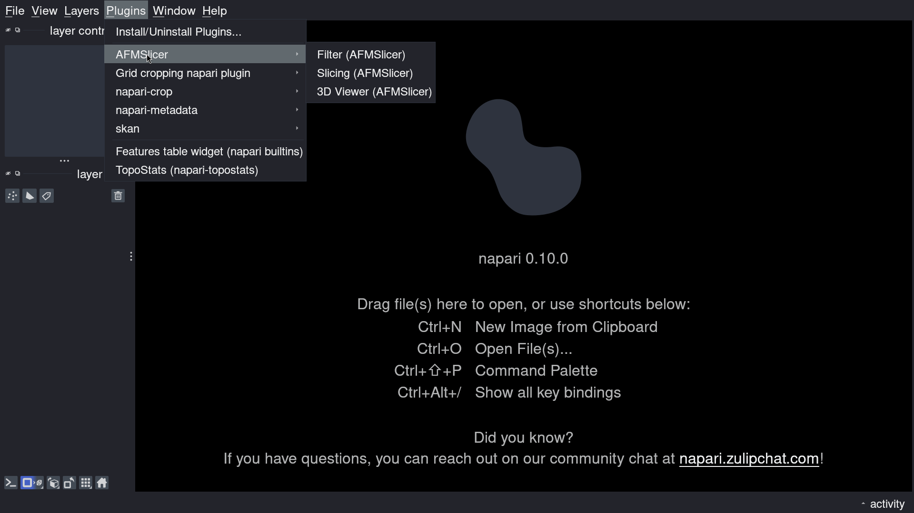

Each of the widgets appears on the right-hand side of Napari.

<!-- markdownlint-disable MD046 -->
=== "Filter"

    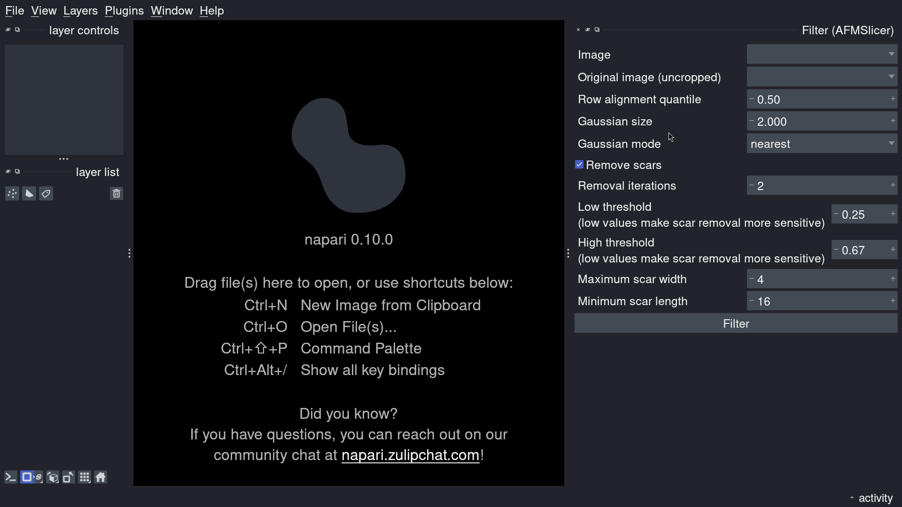

=== "Slicing"

    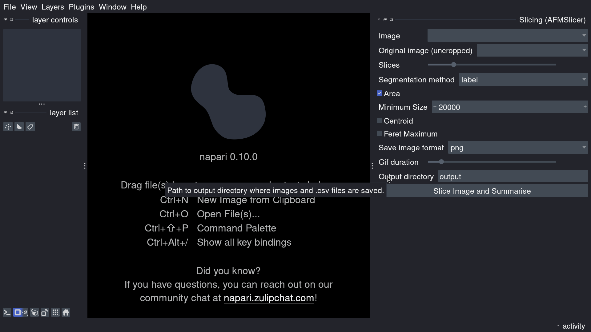

=== "3D-view"

    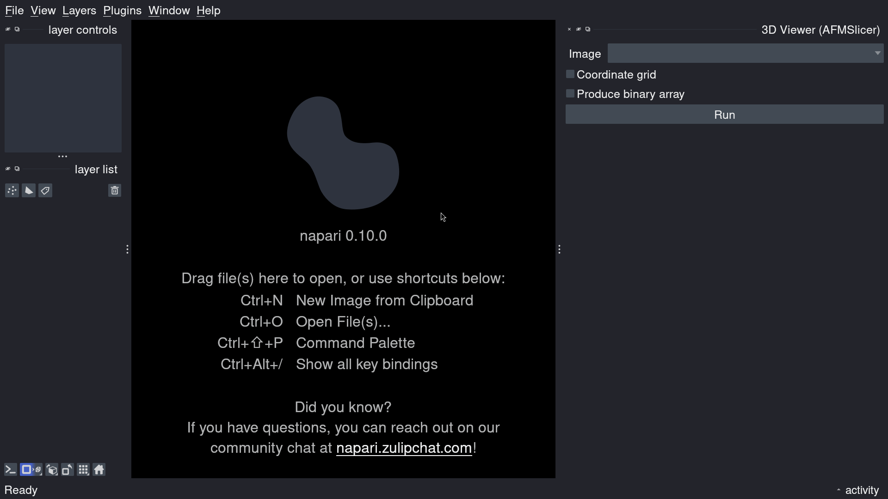

=== "All"

    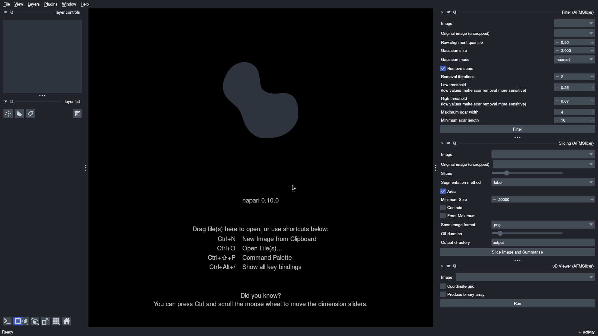

<!-- markdownlint-disable MD046 -->

#### ...with AFMSlicer Widgets

You can automatically load the Napari AFMSlicer plugin with the `-w napari-afmslicer` flag and load all widgets too with
the `__all__` option (see `napari --help` for more details)...

``` shell
napari -w napari-afmslicer __all__
```

Napari will start and the AFMSlicer widgets will be on the right-hand side. Unlike launching the widgets from the
_Plugins_ menu they are tabbed and the tabs appear at the bottom with the active tab highlighted, allowing you to switch
between the _Filtering_, _Slicing_ and _3D Viewer_ AFMSlicer widgets.

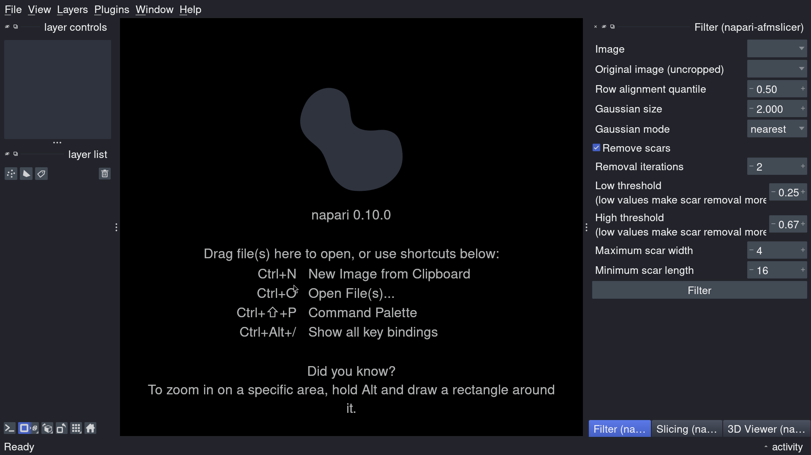

#### Tool Tips

Hovering over a parameter with the mouse will show the associated tool tip for the option which describes what the
setting does and possible options.


## Workflow

A typical workflow will involve...

1. Filtering an image to flatten it, removing scars and apply Gaussian blurring.
2. Optionally selecting and cropping regions of interest.
3. Running slicing on the whole image or each of the selected regions.

### Opening Files

Open files using the menu item `File > Open File(s)` (accessible via the shortcut `Ctrl + O`). You can select more than
one image a time to be loaded, each will be listed on the left as its own "Layer".

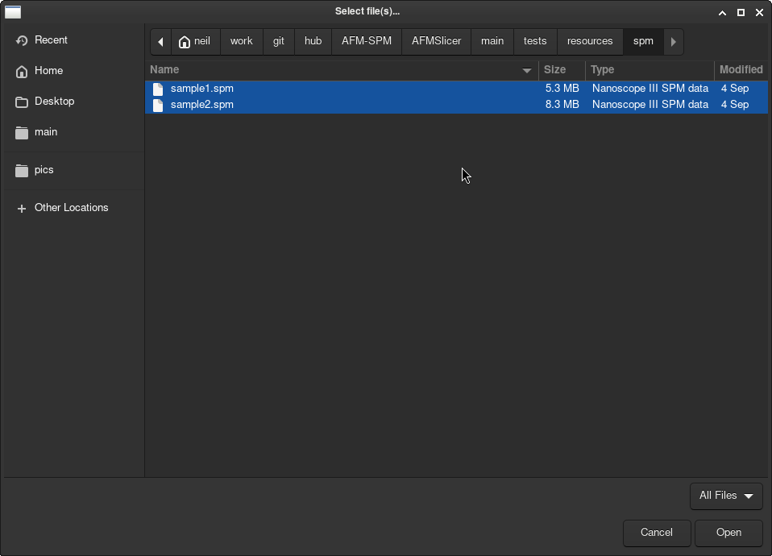

For each image you have opened you are prompted to select the channel for which you wish to load data. This defaults to
`Height Sensor` so unless you want a different channel just hit return and the dialogue box will disappear and the image
will open.

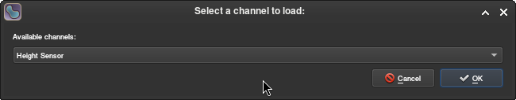

Once opened each image is listed as its own "Layer" in the bottom left of Napari in the _Layer List_. You can toggle
whether a given layer is shown by clicking on the "eye" icon next to it in the _Layer List_.

<!-- markdownlint-disable MD046 -->
=== "`sample1`"

    Hide and show layers by clicking on the box with an "eye" in it.

    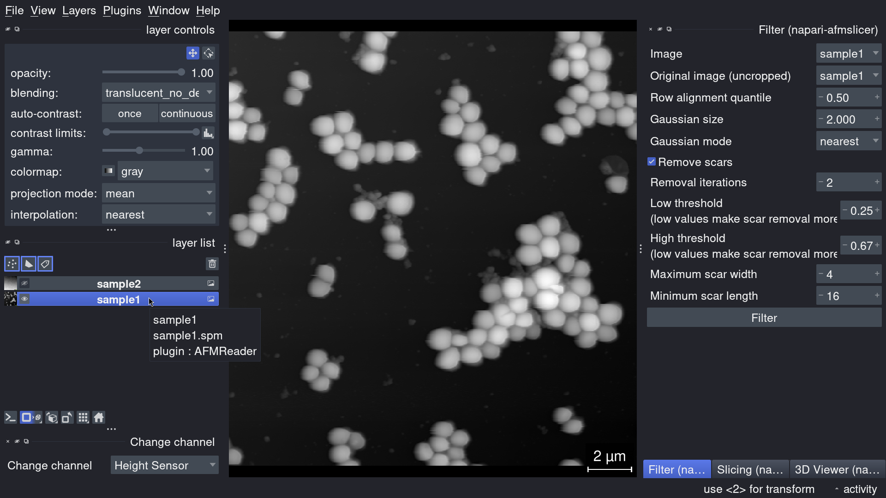

=== "`sample2`"

    Hide and show layers by clicking on the box with an "eye" in it.

    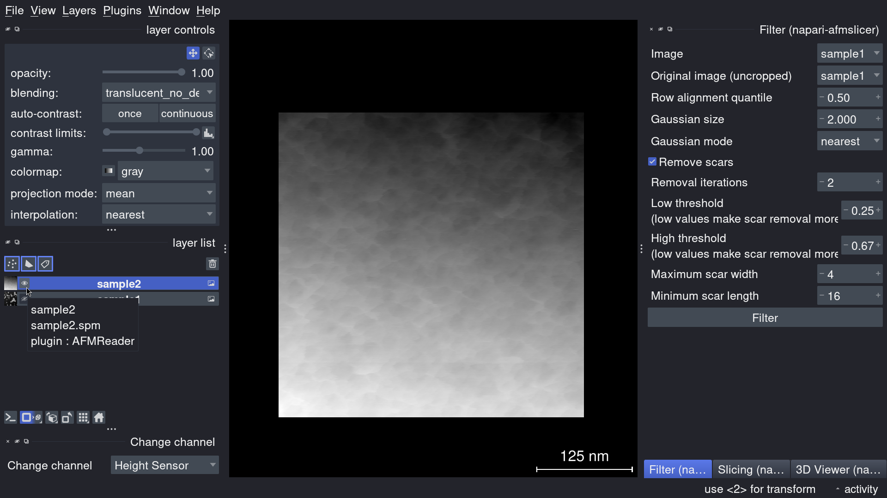

<!-- markdownlint-enable MD046 -->

### Filtering

The parameters for filtering can be configured easily from the _Filter_ widget.

1. Select the _Image_ to filter (you do _not_ have to change _Original image (uncropped)_).
2. Typically _Row alignment quantile_ will not need modifying from `0.50`.
3. _Gaussian Size_ will depend on how much "noise" there is in your image, higher values cause more blurring which can
   mask noise but also blurs boundaries in regions. You may need to experiment with this parameter.
4. _Gaussian mode_ works well with `nearest` but other options are available, for details see `mode` parameter in
[scikit-image][skimage_gaussian].
5. Whether to run scar removals depends on the scan and whether, in your judgement, there are any scars that need to be
   removed.  Unchecking _Remove scars_ will prevent scar removal from running
completely. Otherwise leave enabled, the defaults are generally good but may need adjusting.

Once you are happy with these parameters click on the _Filter_ button, after a short while a new layer will appear
listed as `<image_name>_filtered`

<!-- markdownlint-disable MD046 -->
=== "`sample1_filtered`"

    Hide and show layers by clicking on the box with an "eye" in it.

    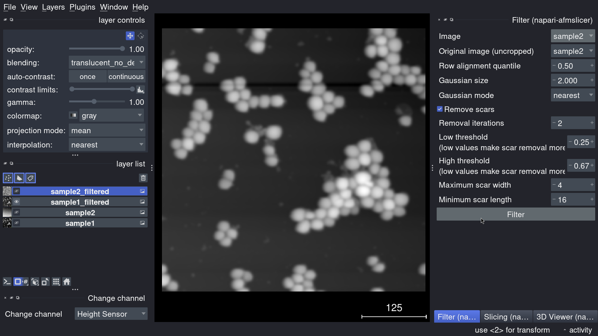

=== "`sample2_filtered`"

    Hide and show layers by clicking on the box with an "eye" in it.

    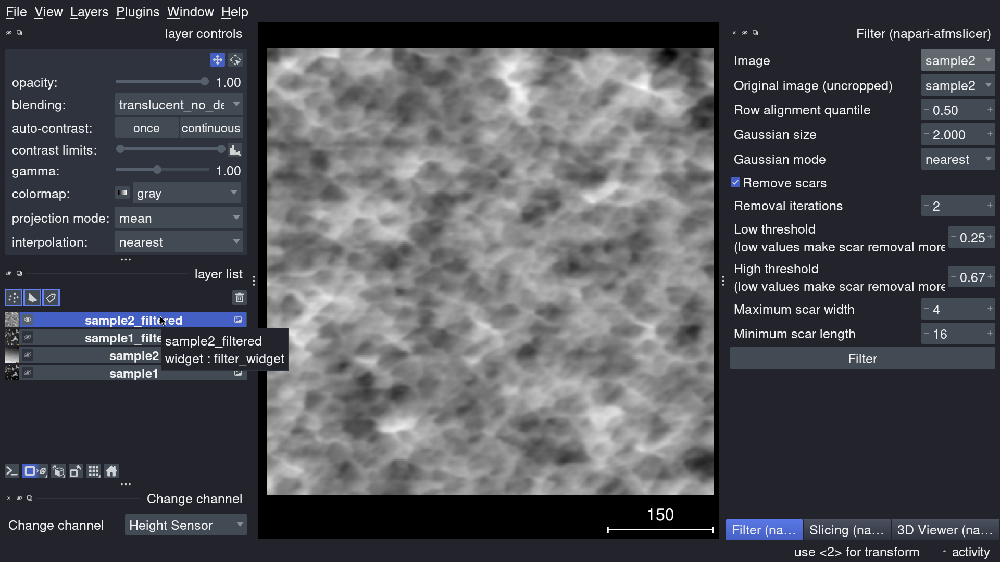

<!-- markdownlint-enable MD046 -->

By filtering _before_ cropping a region you will have a clearer view of the features to select.

### Cropping

_Plugins > napari\_crop_ has three options for cropping, by _Crop Regions_ is the one you are most likely to want to
use which allows free hand selection of a region to crop.

Select the filtered layer, in this example `sample2_filtered`, in the _Layer list_ on the bottom left of the image and
click on the _Shapes_ button at the top of the _Layer List_ region (its a box with a trapezoid in).

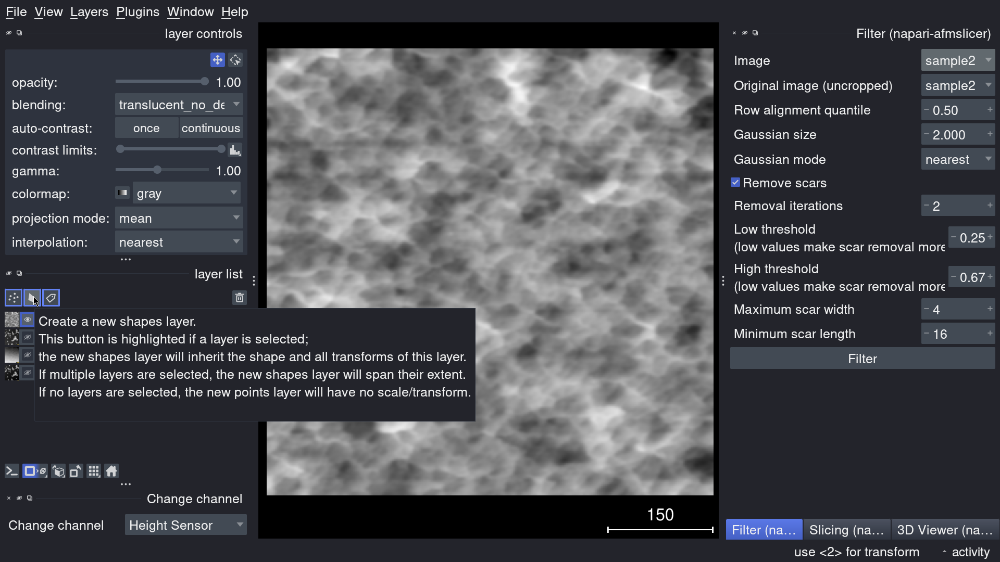

This creates a new layer, `sample3_filtered - Shapes` and the _Layer controls_ box on the left above the _Layer List_
will change and have a number of buttons for selecting and drawing shapes in the image. Select the _Add rectangles (R)_
tool and you can select regions to crop.

<!-- markdownlint-disable MD046 -->
=== "Selecting the _Add rectangles_ tool"

    Select the rectangle select tool from the _layer controls_ widget.

    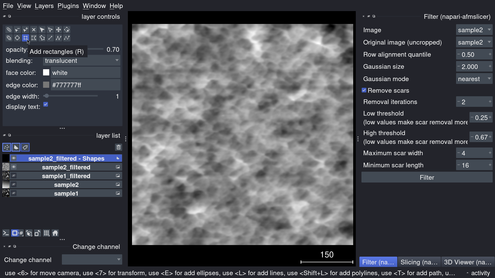

=== "Selecting multiple rectangles to crop"

    Select one or more region to crop.

    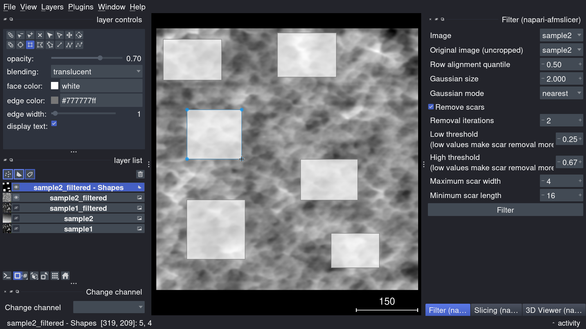

=== "Enable the _Crop Region(s)_ plugin and select the Shapes layer"

    Here we have enabled the _Crop Region(s)_ widget from the _Plugin > napari-crop > Crop Regions_ in the menus and are
    selecting the _layer_ to crop which should be the "filtered" layer (`sample2_filtered`) and the _shapes layer_ should be
    the corresponding "Shapes" layer (`sample2_filtered - Shapes`).

    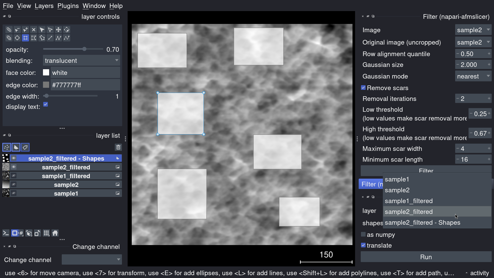

    Now click the _Run_ button under the _Crop Regions_ widget.

<!-- markdownlint-enable MD046 -->

You now have a separate layer for each crop and can toggle which cropped regions to display via the "eye" button on each
layer. Here regions `0`, `2` and `5` are shown whilst `1`, `3`, and `4` are hidden. Note that the `_filtered` layer has
been hidden from display as well as the `Shape` layer which just shows transparent boxes for each of the cropped
regions.

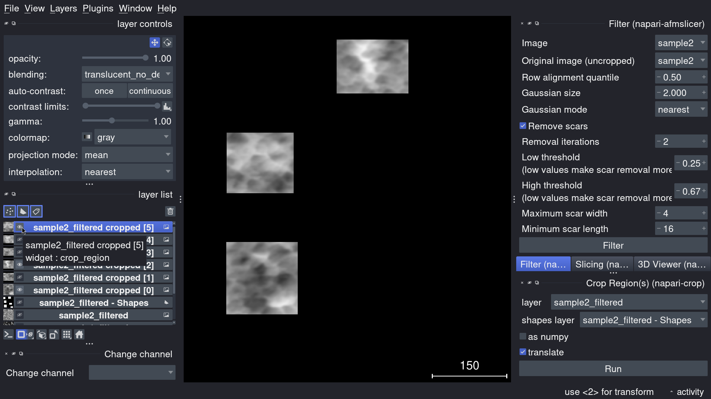

### Slicing

Under the _Slicing_ widget you can now slice your image.

1. Select the image you wish to filter from from the pull-down list to the right of _Image_. This may be the whole,
   filtered image (with the `_filtered` suffix), or it may be one of the crops.
2. Choose the number of _Slices_ to create and the _Segmentation method_ (`label` is fine for the time being,
   `watershed` still needs some work).
3. Enable the statistics to calculate by checking boxes next to _Area_, _Centroid_ and _Feret Maximum_ for those that
   are required.
4. Set the _Minimum size_ of objects, this may require experimentation.
5. Output will by default go to the `output` directory but this can be changed if required.

When ready click on the _Slice Image and Summarise_ button. Once complete a dialog box will pop up at the bottom of the
image area (it may need expanding to show).

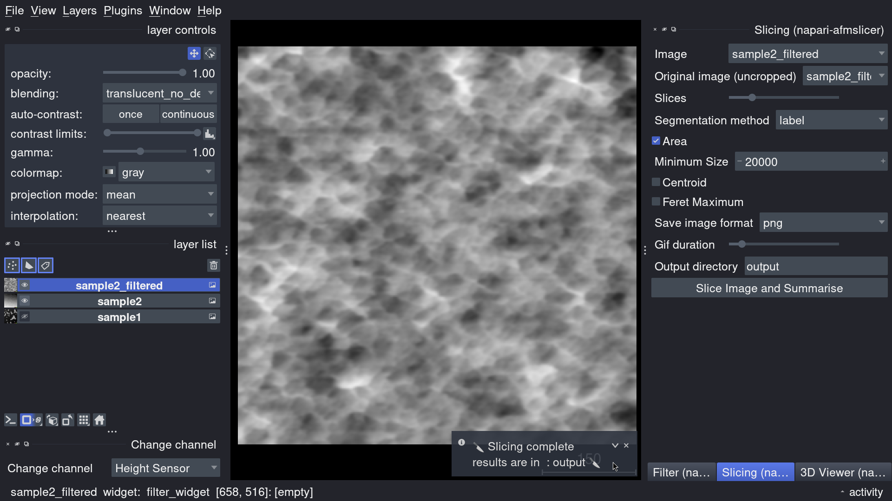

If slicing was successful the message will read _🔪 Slicing complete results are in  : output 🔪_.

### 3D Viewer

The 3D viewer can be used to view the images in three dimensions. Select the `_filtered` layer for the _Image_ to be
viewed and a number of slices to create this image with (it can be different to those the slicing was performed with).

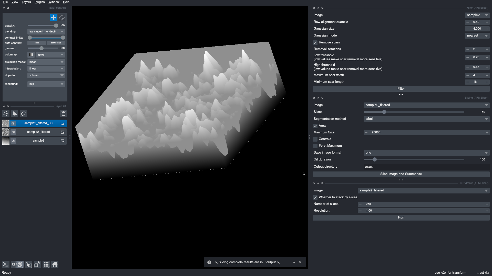

[napari]: https://napari.org/stable/
[napari_afmreader]: https://github.com/AFM-SPM/napari-AFMReader/
[napari_afmslicer]: https://github.com/AFM-SPM/napari-afmslicer
[napari_crop]: https://napari-hub.org/plugins/napari-crop.html
[napari_hub]: https://napari-hub.org/
[napari_install]: https://napari.org/stable/getting_started/installation.html
[napari_skimage]: https://napari-hub.org/plugins/napari-skimage.html
[napari_topostats]: https://github.com/AFM-SPM/napari-TopoStats/
[skimage]: https://scikit-image.org/
[skimage_gaussian]: https://scikit-image.org/docs/stable/api/skimage.filters.html#skimage.filters.gaussian
